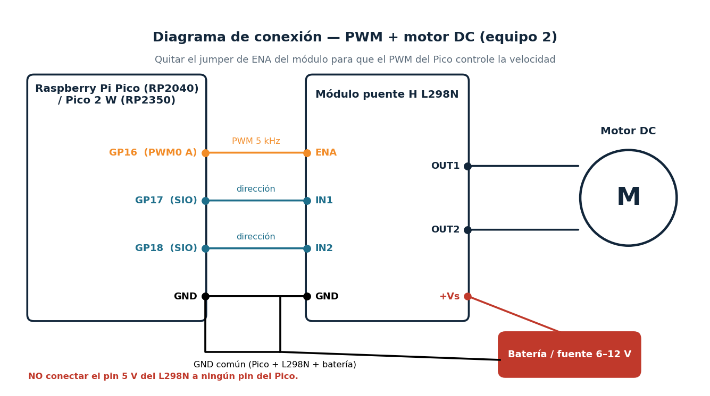

# PWM + Motor DC con puente H en Raspberry Pi Pico (RP2040) y Pico 2 W (RP2350)

**Actividad integradora — Periféricos del microcontrolador**
**Equipo 2 · Periférico: PWM · Integrantes: Ana Cisneros, Leslie Sanchez**

## 1. Objetivo

Configurar y demostrar el periférico **PWM** de la Raspberry Pi Pico (RP2040) y de la Raspberry Pi Pico 2 W (RP2350) controlando la **velocidad y el sentido de un motor DC** mediante un **puente H L298N**, con:

1. Acceso **directo a registros** mediante punteros (`src/pwm_regs.c`).
2. La **misma función con el Pico SDK** (`src/pwm_sdk.c`).
3. Un **comando propio del REPL**: `motor <0-100> <derecha|izquierda>` (`src/motor_cmd.c`).
4. Comparación técnica RP2040 vs RP2350 (`docs/comparacion_rp2040_rp2350.md`).

Cadena demostrada: **comando REPL → C (argc/argv) → periférico PWM → L298N → motor DC**.

## 2. Descripción del hardware

El PWM (Pulse Width Modulation) genera una onda cuadrada de frecuencia fija cuyo **ciclo de trabajo** (% de tiempo en alto) se controla por software. El valor promedio de voltaje en el motor es proporcional a ese ciclo, por lo que varía su velocidad sin disipar calor en una resistencia.

| | RP2040 (Pico) | RP2350 (Pico 2 W) |
|---|---|---|
| Slices PWM | 8 (16 canales) | 12 (24 canales) |
| Dirección base PWM | `0x40050000` | `0x40058000` |
| clk_sys por defecto (SDK) | 125 MHz | 150 MHz |

Pin usado: **GP16 = PWM slice 0, canal A** (en ambos chips). Detalle en `docs/mapa_registros.md`.

## 3. Lista de componentes

| Cant. | Componente |
|---|---|
| 1 | Raspberry Pi Pico (RP2040) |
| 1 | Raspberry Pi Pico 2 W (RP2350) |
| 1 | Módulo puente H L298N (o equivalente: TB6612FNG, L293D) |
| 1 | Motor DC 6–12 V (con reductor, de preferencia) |
| 1 | Fuente externa 6–12 V (4×AA, 2×18650 o fuente de banco) |
| 1 | Protoboard + jumpers |
| 1 | Capacitor cerámico 100 nF entre terminales del motor (recomendado) |
| 2 | Cables micro-USB (programación y REPL) |

## 4. Conexiones



| Pico | L298N | Función |
|---|---|---|
| GP16 | ENA | PWM (velocidad) — **quitar el jumper de ENA** |
| GP17 | IN1 | Dirección |
| GP18 | IN2 | Dirección |
| GND | GND | Tierra común |
| — | +12V / Vs | Batería o fuente (6–12 V) |
| — | OUT1 / OUT2 | Terminales del motor |

> **No conectar el pin 5V del L298N a ningún pin del Pico.** La tierra de la fuente del motor, del L298N y del Pico debe ser común. Con el motor en reversa no cambie el sentido bruscamente: el firmware ya inserta una pausa de 150 ms.

Tabla de verdad usada (L298N):

| ENA | IN1 | IN2 | Resultado |
|---|---|---|---|
| PWM | 1 | 0 | Giro a la derecha, velocidad = duty |
| PWM | 0 | 1 | Giro a la izquierda |
| 0 | x | x | Rueda libre |
| 1 (100 %) | 1 | 1 | Freno |

## 5. Software y herramientas

- Raspberry Pi **Pico SDK 2.x** (obligatorio ≥ 2.0 para RP2350)
- CMake ≥ 3.13, `arm-none-eabi-gcc`, Python 3
- Terminal serial: `minicom`, PuTTY, Tera Term o el monitor serial de VS Code
- Opcional: simulación en [Wokwi](https://wokwi.com) (`wokwi/diagram.json`)

## 6. Compilación

Copie una vez el archivo de importación del SDK:

```bash
export PICO_SDK_PATH=/ruta/a/pico-sdk
cp $PICO_SDK_PATH/external/pico_sdk_import.cmake .
```

**RP2040 (Raspberry Pi Pico):**
```bash
mkdir build_rp2040 && cd build_rp2040
cmake .. -DPICO_BOARD=pico
make -j4
```

**RP2350 (Raspberry Pi Pico 2 W):**
```bash
mkdir build_rp2350 && cd build_rp2350
cmake .. -DPICO_BOARD=pico2_w
make -j4
```

Cada carpeta produce `pico_pwm_motor.uf2`. El mismo código fuente compila para ambos chips: `src/chip_map.h` selecciona direcciones y campos con `PICO_RP2040` / `PICO_RP2350`.

## 7. Carga del programa

1. Mantenga presionado **BOOTSEL** y conecte el USB (aparece la unidad `RPI-RP2` o `RP2350`).
2. Copie `pico_pwm_motor.uf2` a esa unidad; la placa reinicia sola.
3. Abra el puerto serial (115200 8N1, cualquier velocidad funciona en USB-CDC).

## 8. Uso del REPL

```
pico> help
pico> chip
pico> motor 50 derecha
pico> motor 80 izquierda
pico> motor rampa 100 2000
pico> motor parar
pico> motor freno
pico> motor freq 10000
pico> motor modo sdk
pico> motor info
```

| Comando | `argv` | Acción física |
|---|---|---|
| `motor 50 derecha` | `argv[0]="motor"`, `argv[1]="50"`, `argv[2]="derecha"` | CC_A=500, IN1=1, IN2=0 → gira a la derecha al 50 % |
| `motor parar` | `argv[1]="parar"` | CC_A=0, IN1=IN2=0 → rueda libre |
| `motor freno` | `argv[1]="freno"` | IN1=IN2=1, ENA=100 % → frenado |
| `motor freq <1000-20000>` | `argv[2]` = Hz | Reescribe `PWM_DIV` |
| `motor modo reg\|sdk` | `argv[2]` | Cambia entre punteros y SDK en caliente |
| `motor rampa <0-100> <ms>` | `argv[2]`,`argv[3]` | Cambia `CC_A` gradualmente |
| `motor info` | — | Imprime CSR, DIV, TOP y CC del slice |

Todos los argumentos se **validan** (rango, formato numérico, número de argumentos); un error imprime el modo de uso.

**Integración con el REPL del curso:** si ya cuentan con la tabla de comandos del curso, copien `motor_cmd.c/.h`, `pwm_regs.c`, `pwm_sdk.c`, `pwm_backend.h`, `chip_map.h`, `board_config.h` y agreguen una entrada `{ "motor", "...", cmd_motor }`. La firma `int cmd_motor(int argc, char **argv)` es la misma de `main`. Llamen a `motor_init()` antes de arrancar el REPL.

## 9. Implementación mediante registros (`src/pwm_regs.c`)

Secuencia: **dirección base → offset → dirección del registro → puntero → valor → periférico.**

```c
#define REG32(addr)  (*(volatile uint32_t *)(uintptr_t)(addr))
#define PWM_CC(s)    (PWM_BASE + (s) * 0x14u + 0x0Cu)

REG32(PWM_CC(0)) = 500;   // PWM0 CC_A = 500  -> 50 % con TOP = 999
```

Pasos de `regs_init()`: (1) sacar de reset IO_BANK0, PADS_BANK0 y PWM (`RESETS`); (2) limpiar `ISO` del pad en RP2350; (3) `FUNCSEL = 4` (PWM) en `GPIO16_CTRL`; (4) `TOP = 999`, `DIV` según frecuencia, `CC = 0`; (5) `CSR.EN = 1`. Los pines de dirección usan `FUNCSEL = 5` (SIO) y los registros `GPIO_OE_SET`, `GPIO_OUT_SET/CLR`.

Explicación de `volatile`, máscaras, tamaño de registro y alias atómicos (`+0x2000` SET, `+0x3000` CLR): ver `docs/mapa_registros.md`.

## 10. Implementación mediante SDK (`src/pwm_sdk.c`)

```c
gpio_set_function(PIN_ENA, GPIO_FUNC_PWM);
uint slice = pwm_gpio_to_slice_num(PIN_ENA);
pwm_config cfg = pwm_get_default_config();
pwm_config_set_wrap(&cfg, 999);
pwm_config_set_clkdiv(&cfg, 25.0f);       // 30.0f en RP2350
pwm_init(slice, &cfg, true);
pwm_set_gpio_level(PIN_ENA, 500);
```

El SDK abstrae: direcciones base, offsets, resets, mapeo GPIO→slice/canal, formato 8.4 de `DIV`. Sus funciones terminan escribiendo los **mismos registros** (`pwm_hw->slice[n].csr/div/cc/top`). Con `motor info` se comparan los valores de ambos modos.

## 11. Diferencias RP2040 / RP2350

Resumen (completo en `docs/comparacion_rp2040_rp2350.md`):

- Dirección base del PWM: `0x40050000` → `0x40058000`; 8 → 12 slices; `PWM_EN` en `+0xA0` → `+0xF0`.
- `RESETS`, `IO_BANK0`, `PADS_BANK0` cambian de dirección y el bit de reset del PWM pasa de 14 a 16.
- RP2350: los pads salen del reset **aislados** (`PADS.ISO = 1`): hay que limpiarlo.
- SIO: `GPIO_OUT_SET/CLR` y `GPIO_OE_SET` cambian de offset (`0x14/0x18/0x24` → `0x18/0x20/0x38`).
- `clk_sys`: 125 → 150 MHz, por lo que `DIV` para 5 kHz pasa de 25 a 30.
- SDK: misma API; cambian `PICO_BOARD`, macros `PICO_RP2040/PICO_RP2350` y las estructuras de `hardware/structs`.

## 12. Procedimiento para reproducir la demostración

1. Cablear según la sección 4 con la fuente del motor **apagada**.
2. Cargar el `.uf2` correspondiente y abrir el REPL.
3. `chip` → verifica RP2040 o RP2350. `motor info` → registros del slice.
4. `motor 30 derecha` → `motor 70 derecha` → observar el aumento de velocidad.
5. `motor 50 izquierda` → observar la inversión (pausa de 150 ms).
6. `motor modo sdk` y repetir el paso 4: mismo comportamiento, mismos valores de registros.
7. `motor freq 1000` y `motor freq 20000` → cambia el tono/zumbido del motor.
8. `motor parar`.
9. Repetir en la otra tarjeta y registrar evidencias (`evidencias/README.md`).

## 13. Estructura del repositorio

```
.
├── README.md
├── CMakeLists.txt
├── pico_sdk_import.cmake        (copiar del SDK, ver sección 6)
├── src/
│   ├── main.c  repl.c/.h  motor_cmd.c/.h
│   ├── pwm_regs.c               implementación con punteros
│   ├── pwm_sdk.c                implementación con Pico SDK
│   ├── pwm_backend.h  chip_map.h  board_config.h
├── wokwi/                       diagram.json + PWM.c
├── docs/                        mapa de registros, comparación, guía
├── presentacion/                PDF
├── evidencias/                  capturas
```

## 14. Referencias

1. Raspberry Pi Ltd. *RP2040 Datasheet* — capítulo PWM, RESETS, IO_BANK0, SIO. <https://datasheets.raspberrypi.com/rp2040/rp2040-datasheet.pdf>
2. Raspberry Pi Ltd. *RP2350 Datasheet* — capítulo PWM, RESETS, IO_BANK0, SIO. <https://datasheets.raspberrypi.com/rp2350/rp2350-datasheet.pdf>
3. Raspberry Pi Ltd. *Raspberry Pi Pico-series C/C++ SDK*. <https://datasheets.raspberrypi.com/pico/raspberry-pi-pico-c-sdk.pdf>
4. Raspberry Pi Pico SDK API, `hardware_pwm`. <https://www.raspberrypi.com/documentation/pico-sdk/>
5. STMicroelectronics. *L298 Dual Full-Bridge Driver, Datasheet*.
6. Wokwi. *Raspberry Pi Pico reference*. <https://docs.wokwi.com/parts/wokwi-pi-pico>
